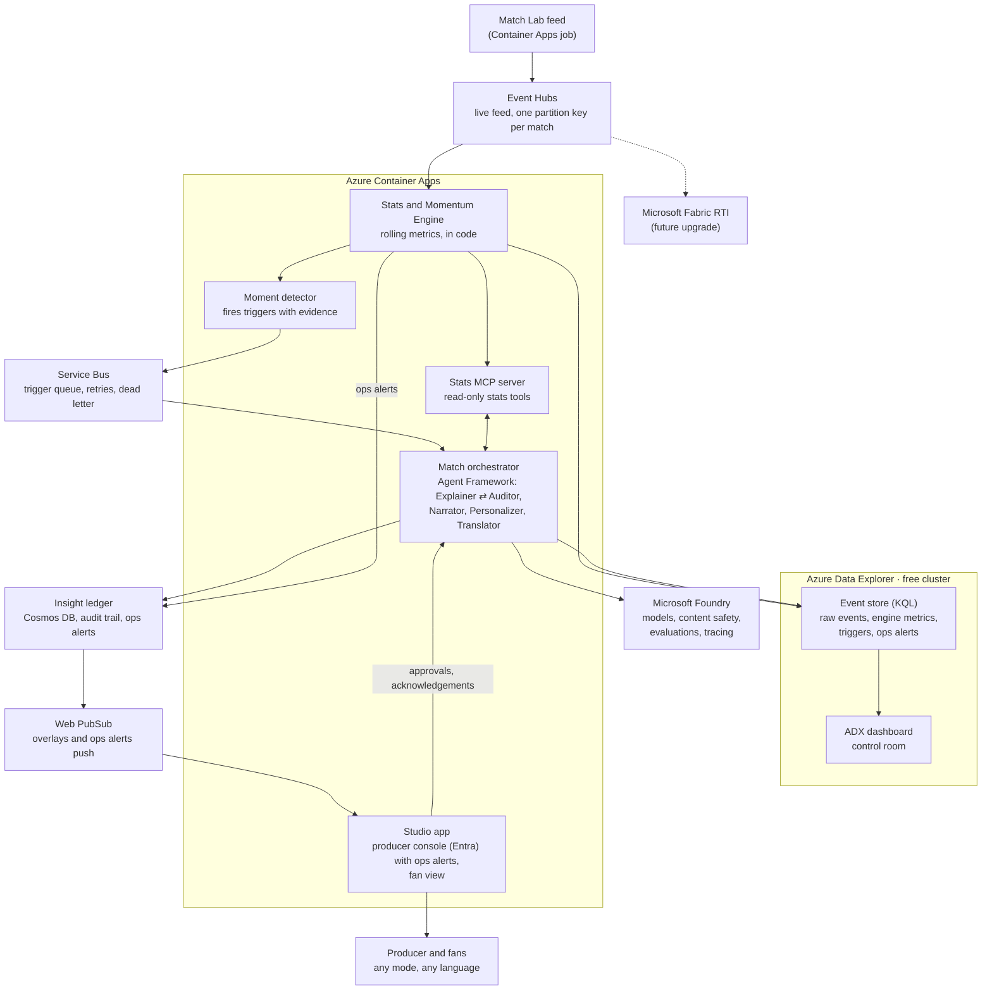

# Architecture

Azure Event Hubs carries the live match feed, Azure Data Explorer (free cluster) stores events and engine metrics for KQL queries and the control-room dashboard, Container Apps runs the Python engine and the agents, and Microsoft Foundry supplies models and guardrails. Every insight is audited before it reaches a screen. The feed and the event store sit behind adapters, so Microsoft Fabric Real-Time Intelligence can take over later as an upgrade (see Future upgrade: Microsoft Fabric).

Across every service: Microsoft Entra ID (managed identities, producer sign-in), Log Analytics (Application Insights to come), GitHub Actions, Cost Management budget alerts; Key Vault only if a secret ever appears (none today: every service is reached with a managed identity).

## How one moment flows

1. **Generate.** The Match Lab replays a synthetic match and sends events and 1 Hz tracking samples to the live feed (Azure Event Hubs), one batch per second of match time.
2. **Ingest.** The Stats and Momentum Engine reads the feed through the feed adapter. Validation rules reject or flag bad rows; rejects raise an ops alert. The engine appends the raw rows to the event store in Azure Data Explorer.
3. **Compute.** The engine updates team and player state in rolling 5-minute windows: possession, turnovers, PPDA, control and chaos scores, speeds and distances. It writes these snapshots to the event store, so the dashboard shows the same numbers the agents use.
4. **Detect.** The Moment detector sees, for example, the away side's build-up evidence (passes, pressure and possession) cross its threshold, computes the moment's metrics with context (before and after windows, the score, the opponent's shots in the spell), folds a repeat alert into the moment it repeats, then puts a trigger with evidence event IDs on the Service Bus queue.
5. **Explain.** The orchestrator picks up the trigger. The Explainer pulls numbers through the Stats MCP server and drafts an insight (headline, explanation, metrics, evidence).
6. **Audit.** The Auditor recomputes every number through the same tools. A mismatch goes back to the Explainer, at most twice; then approve or block. The decision is written to the ledger; a block raises an ops alert.
7. **Approve.** The producer approves in the Studio app (low-risk types such as speed alerts can auto-approve).
8. **Personalize and translate.** Personalizer writes the analyst, casual, club, player and single-metric versions in one call; then, per mode concurrently, the Translator renders the other languages in one call. Every copy passes the number check and the editorial check, or is asked for again alone once, then falls back to template copy.
9. **Deliver.** The Overlay builder sets template, timing and priority; overlays are saved to the ledger and pushed through Web PubSub.
10. **Recap.** At half-time and full-time the orchestrator hands off to the Narrator; recaps go through the same audit.

Alongside the flow, the producer console shows **ops alerts** (feed gaps, feed lag, validation rejects, blocked insights, dead-lettered triggers, model fallbacks) as they happen, and the **ADX dashboard** gives producers and analysts the control-room view of the match and the pipeline.

## Components

| Component | Azure service | Role | Challenge stage | Scope |
| --- | --- | --- | --- | --- |
| Match Lab | Container Apps job (Python) | Synthetic matches + planted scenarios; live replay | (a) ingest, (v) data | Core |
| Live feed | Azure Event Hubs (Basic) | Carry events and tracking from the Match Lab to the engine | (a) | Core |
| Event store | Azure Data Explorer free cluster (KQL database) | Raw events and tracking, engine metric snapshots, triggers, insight status, ops alerts; time-window queries; eval checks | (a), (b) | Core |
| Control-room dashboard | ADX dashboard | Producer and analyst control room: match state, momentum, triggers, feed health, insight pipeline | (b), (d) | Core |
| Ops alerts | Studio producer console (ledger + Web PubSub) | Feed gaps and lag, validation rejects, blocked insights, dead letters, model fallbacks; producer acknowledges | Ops | Core |
| Stats and Momentum Engine + Moment detector | Container Apps (Python) | Deterministic metrics and triggers | (b), (c) | Core |
| Service Bus queue | Service Bus (Basic) | Trigger queue `triggers`; max 3 deliveries, then dead letter; adapter `infra_adapters/servicebus.py` | (c) | Core |
| Stats MCP server | Container Apps | Read-only stats tools for agents | (b), (c) | Core |
| Match orchestrator | Container Apps + Microsoft Agent Framework | Five agents + Overlay builder | (c), (d), (e) | Core |
| Microsoft Foundry | Foundry | Models, content safety, evaluations, tracing | (c), (e) | Core |
| Insight ledger | Cosmos DB (free tier) | System of record: insights, evidence, audits, approvals, overlays, ops alerts, viewer profiles. One container `ledger`, partition key `/match_id`; write-through adapter `infra_adapters/cosmos.py` | (c), (d) | Core |
| Web PubSub | Web PubSub (Free tier), hub `studio` | Change signals to the Studio per match (`fans.<match>`, `producers.<match>`); clients re-read through the API | (d) | Core |
| Studio app | Container Apps (web), Next.js (`studio/`) | Producer console (ops alerts, queue, audit trail, evidence, approve/block) + fan view with mode, language, club (player and metric pickers to come); calls `/api/v1` through a Next.js rewrite | (d), (e) | Core |
| Match history (medallion) | Fabric Lakehouse | Bronze/Silver/Gold history | (b) | Stretch (needs Fabric) |
| "Ask the match" | Fabric data agent + Foundry | Natural-language questions for analysts | (e) | Stretch (needs Fabric) |

## Live feed

- **Interface:** `pitch_ledger.feed` defines `FeedPublisher` and `FeedSubscriber`. Adapters: a JSONL file (two local processes), in-memory (tests) and Azure Event Hubs (`infra_adapters/eventhubs.py`). `PITCH_LEDGER_FEED` picks one; domain code never imports the Event Hubs SDK.
- **Messages:** the body is the feed row exactly as in `events.jsonl` / `tracking.jsonl`, except that runs of tracking rows are packed as a JSON array (up to 100 rows: about 22 players per match second would otherwise be 22 messages, and the SDK's cost is per message; one row per message capped the live service at about 350 rows a second on 1 vCPU, below the 560 a second of a 25x stream); properties carry the row kind and the send time (for latency). The partition key is the match ID, so each match's rows arrive in order. A match opens with one `match` message carrying its reference rows (teams, players).
- **Sign-in:** Microsoft Entra ID (managed identity in Azure, the service principal locally), roles *Azure Event Hubs Data Sender* (Match Lab) and *Data Receiver* (engine). A SAS connection string also works.
- **Transport:** plain AMQP inside Azure; AMQP over WebSockets (port 443) behind a proxy (`PITCH_LEDGER_EVENTHUB_TRANSPORT`, default `auto`).
- **Measured (2026-10-09, from a Claude Code cloud session through its proxy, WebSockets):** no messages lost in any of five runs (up to 2,695 messages each); send-to-receive p50 2.5–3.3 s, p95 4.6–7.3 s. A single send takes about 0.27 s; delivery arrives in bursts on this path (best case 0.6 s). This is a pessimistic bound, not the Azure number: re-measure from Container Apps (same region, plain AMQP) in Phase 4.
- **Commands:** `pitch-ledger stream <match_dir>` publishes at match pace (overdue seconds are sent together when publishing falls behind); `pitch-ledger listen` lands the rows and reports send-to-receive latency.
- **Throughput:** Event Hubs Basic with 1 throughput unit accepts about 1,000 messages a second; a match is about 23 a second at real time, so replays stay at or below about 40x (60x was throttled).

## Live service (`pitch-ledger live`)

One process, two concurrent loops (`pitch_ledger.live`):

1. **Ingest:** reads the feed, keeps each match in memory and lands it under `data/live/<match>/` (a match directory the stats tools read), writes raw rows, minute snapshots and feed health to the event store, and every few seconds re-runs the detector over everything received. A trigger is emitted once the feed is 60 match-seconds past it (first-half triggers at the start of the second half; everything at full time) and numbered in match order, so a live run gives exactly the batch triggers (checked on all planted matches). Triggers go to the queue, `triggers.jsonl` and the store.
2. **Worker:** takes triggers off the queue and runs the orchestrator over a snapshot of the match so far; insights, audits and overlays go to the ledger, insight status to the store. `--approve` approves as the demo producer; otherwise insights wait for the producer console.

The feed, queue, ledger and store are the same interfaces as everywhere else (Event Hubs, Service Bus, Cosmos DB, ADX in Azure; files and memory locally).

## Event store and dashboard (Azure Data Explorer)

- **Free cluster:** an Azure Data Explorer free cluster (no Azure cost, no SLA) with one database. `ADX_CLUSTER_URI` and `ADX_DATABASE` locate it. It speaks KQL, the same language and engine as a Fabric Eventhouse.
- **Writers, not a second source of truth:** the engine appends raw rows and its metric snapshots; the orchestrator appends trigger and insight status rows and ops alerts. Cosmos DB stays the system of record for the ledger; ADX is the analytical copy for queries and the dashboard. Writes go through the event-store interface (`pitch_ledger.eventstore`; ADX adapter in `infra_adapters/adx.py`), batched every few seconds or 5,000 rows and sent by managed streaming ingestion; domain code never imports the Kusto SDK. `pitch-ledger store <match_dir>` writes a whole match; `listen --store` writes rows and feed health as they arrive.
- **Tables:** `Events` and `Tracking` (feed rows, schema doc columns), `TeamState` (engine snapshots per team every minute over the rolling 5-minute window), `Triggers`, `InsightStatus`, `OpsAlerts`, `FeedHealth` (latency per minute), `StoreCheck` (setup test). Defined once in `src/pitch_ledger/eventstore/tables.py`; `infra/adx/tables.kql` (from `pitch-ledger store-schema`) creates them with JSON mappings, streaming ingestion and a 10-second batching fallback. Tile queries: `infra/adx/dashboard.kql`.
- **Same numbers everywhere:** dashboard tiles show engine-computed values from `TeamState` and `Triggers`; KQL only filters, counts and charts them (and computes feed-health timings). The dashboard never derives its own football metrics, so the studio, the ledger and the dashboard agree.
- **ADX dashboard (control room):** match clock and score, control score per team over time with momentum triggers marked, possession and pressing by window, feed latency and gaps, insight pipeline (drafted, blocked, approved, aired), latest ops alerts. Built in the Azure Data Explorer web UI against the free cluster; the tile queries are kept in the repo.
- **Local-first:** without ADX settings, the event-store adapter writes the same tables as local files, so everything still runs offline.

## Live push (Web PubSub)

- **Signals, not data:** when the live worker stores an insight, or a producer approves or blocks one, the server sends `{"event": "insight_changed" | "overlays_changed", "match_id", "insight_id", "status"}` to the match's group (`producers.<match>`, and `fans.<match>` once aired). Clients then re-read through the API, so the rule "fans see aired overlays only" lives in one place.
- **Connecting:** the browser gets a short-lived URL (60 minutes, one group) from `/api/v1/realtime/negotiate` (fans) or `/negotiate/producer` (producer sign-in) and connects straight to Web PubSub.
- **Fallbacks:** push off or disconnected, the fan view polls every 5 s and the producer console every 10 s; while push is connected a 30 s poll stays as a safety net. Sends fail open (logged): the ledger is the source of truth.
- **Interface:** `pitch_ledger.push.Notifier`; `NullNotifier` locally, `infra_adapters/webpubsub.py` in Azure (`PITCH_LEDGER_PUSH=webpubsub`).

## Ops alerts (producer console)

| Alert (`kind`) | Severity | Raised by | Rule |
| --- | --- | --- | --- |
| Feed gap (`feed_gap`) | warning | Live service, ingest | No feed message for 10 s while a period is being played; one alert per gap (half time is not a gap) |
| Feed lag (`feed_lag`) | warning | Live service, ingest | p95 send-to-receive latency above 5 s over a wall-clock minute (the `FeedHealth` row) |
| Validation reject (`validation_reject`) | warning | Live service, ingest validation | Rejected rows, summarized every tick; the row is dropped before the engine, the match folder and the store |
| Validation flag (`validation_flag`) | info | Live service, ingest validation | Rows passed with a warning, summarized at most once a minute |
| Insight blocked (`insight_blocked`) | warning | After each trigger (Auditor's `block` record) | The Auditor blocked a draft after its last round; it never airs |
| Trigger dead-lettered (`trigger_dead_lettered`) | critical | Live worker, replay | A trigger failed every delivery attempt (3) |
| Model fallback (`model_fallback`) | info; warning when the budget is spent | After each trigger and each producer decision (`fallback` records) | Template copy was used, or the model call budget ran out |

- **Record:** each alert is an `ops alert` in the ledger (`M0002-X0001`: match, kind, severity, message, references to events, triggers, insights or audit records, raised time, acknowledged by and when), appended to the `OpsAlerts` table (a second row when acknowledged; the store only appends) and signalled to the match's producers (`alert_changed` through Web PubSub; the console re-reads). An alert with references is raised once: re-running a match or re-checking an insight adds nothing.
- **Rules read what is already recorded:** blocked and fallback alerts come from the audit trail the agents wrote, so alerts never judge an insight a second time. Code: `pitch_ledger.ops` (`OpsDesk`, `review_insight`, `dead_lettered`, `FeedWatch`).
- **Ingest validation in the live service:** every row goes through the row and sequence rules once the match reference has arrived. A feed joined mid-match (`stream --start-min`) cannot know the lineup or the previous sequence number, so it gets the rules that need no earlier rows; end-of-match checks run at full time of a complete match.
- **Console:** an ops panel above the insight queue (open alerts first, severity, message, references; an insight reference opens that insight) where the producer acknowledges each alert; acknowledged alerts stay listed, dimmed. Without push it refreshes with the queue every 10 s.
- **Demo:** `stream --fault-at MIN` sends one off-pitch row at that minute and then pauses the feed 12 s, so the live service raises a validation reject and a feed gap.
- **Production path:** Application Insights logs and Azure Monitor alert rules for out-of-hours notification; Activator on the `OpsAlerts` table with Fabric.

## API (`/api/v1`)

FastAPI (`pitch_ledger.api`, `pitch-ledger api`); OpenAPI docs at `/api/v1/docs`. Reads the same ledger as the orchestrator (local files or Cosmos DB) and the match files.

| Endpoint | Who | Returns |
| --- | --- | --- |
| `GET /api/v1/health` | anyone | status, ledger, match count |
| `GET /api/v1/matches`, `GET /api/v1/matches/{id}` | anyone | teams, kickoff, venue; players' display names, score, last minute |
| `GET /api/v1/matches/{id}/overlays?mode=&language=` | anyone (fan view) | overlays of **aired** insights only, in match order |
| `GET /api/v1/matches/{id}/timeline` | anyone | every event on one clock: type, outcome, players, positions in the broadcast frame, travel time, score after the event, feed flag |
| `GET /api/v1/matches/{id}/tracking?period=&from_s=&to_s=` | anyone | player positions per second (broadcast frame) for up to five minutes |
| `GET /api/v1/matches/{id}/analytics` | anyone | the engine's team state per minute (control score, possession share, PPDA) and every shot with its xG, outcome, broadcast-frame location and running team totals |
| `GET /api/v1/matches/{id}/pass-network?team=&period=&end_ms=&window_s=600` | anyone | one team's completed passes in a window of a half: players at their average passing position, passes between each pair |
| `GET /api/v1/insights/{id}/story` | anyone (aired only) | the Insight Story: pipeline stages, every agent step with unsupported numbers marked, evidence events, overlays; no producer identity |
| `GET /api/v1/insights/{id}/broadcast` | anyone (aired only) | the broadcast package (schema doc) |
| `GET /api/v1/me` | producer | the signed-in producer |
| `GET /api/v1/matches/{id}/insights?status=` | producer | every insight with status (aired, pending, blocked) |
| `GET /api/v1/insights/{id}` | producer | insight, audit trail, cited evidence events, overlays |
| `POST /api/v1/insights/{id}/decision` | producer | approve or block; approval runs the Personalizer and Translator |
| `GET /api/v1/matches/{id}/alerts?state=open\|all` | producer | the match's ops alerts, newest first |
| `POST /api/v1/alerts/{id}/acknowledge` | producer | mark an alert as seen (identity from the token; the first acknowledgement stays) |

- **Producer sign-in:** the Studio signs in with MSAL (redirect flow, authorization code with PKCE) and sends a Microsoft Entra ID access token for the API's `access_as_producer` scope; the API verifies audience, signature, expiry and issuer. Access is a setting: `role` (production) admits this tenant's users with the `Producer` app role; `any_account` (the public demo) admits any Microsoft account, work or personal, so judges can try the console. The producer's identity (recorded as `approved_by`) comes from the verified token, never from the request. If the API's Entra settings are missing, producer endpoints refuse (fail closed); `PITCH_LEDGER_API_AUTH=dev` is a local-only stand-in.
- **Match Centre (Studio `/matches/[id]`):** the match replayed on a clock (1× to 60×, scrubber, key-moment jumps, `?t=<minute>` deep links): score as of the clock, a 2D pitch with every player from the 1 Hz tracking and the ball's path built from the events (passes and shots fly from start to end over their travel time, a player in possession keeps it at their feet, a loose ball rolls to the next touch, and it rests faded while play is stopped, in the net after a goal), a broadcast lower-third when the clock passes an aired insight (in the viewer's mode and language, linked to its story), a feed of key events and insights, and charts that follow the clock (control score per team with momentum-insight markers, a shot map sized by xG, and each team's pass network over the last ten minutes). Data from `pitch_ledger.api.match_centre` (cached per match, gzip); the browser only places and interpolates positions.
- **Insight Story (Studio `/insights/[id]`, linked from every fan-view card as "How we know"):** one aired insight traced Detected → Analyzed → Explained → Audited → Approved → Published, the agent handoffs with the planted error and the Auditor's finding, the computed numbers and evidence events, the same moment in three audience modes, and the broadcast JSON. Built from ledger records only (`pitch_ledger.api.story`); pending and blocked insights stay in the producer console.
- **Controls:** request bodies reject unknown fields; IDs are pattern-checked before they reach a file path; CORS is limited to the Studio's origin; decisions are rate-limited per producer (they cost model calls); responses are dedicated schemas (fans never see ratings, audits or pending insights).

## Agents and orchestration

| Agent | Job | Model tier | Pattern |
| --- | --- | --- | --- |
| Explainer | What happened, then why it matters (a comparison, the match state, the opponent's response), from metrics and context signals chosen in code; cites evidence events | Stronger | Sequential; maker in maker-checker loop |
| Auditor | Recomputes every number; checks editorial form in code (length, clichés, unsupported claims, repetition); a model checks claims, tone, neutrality; approve, correct or block | Stronger | Checker (max 2 rounds; style-only failures air as template copy) |
| Narrator | Half-time and full-time recaps: do the chances back the scoreline, how the match moved | Stronger | Handoff at breaks; output audited |
| Personalizer | Analyst, casual, club, player and single-metric versions: same facts, different depth and angle | Small, fast | One call for all modes |
| Translator | Each version into the other languages, numbers unchanged | Small, fast | Concurrent per mode, one call for both languages |

A full-flow insight costs 8 model calls when every check passes (Explainer, review, Personalizer, five Translator calls), down from 17; speed alerts use none.

Failure handling: a model error retries once, then falls back to a plain template overlay built from code-computed numbers; a blocked insight never airs and is logged; Service Bus dead-letters a trigger that keeps failing. Each of these raises an ops alert.

## Enterprise controls (built)

- **No numbers from the model.** Every figure comes from code via read-only MCP tools; the Auditor recomputes before air.
- **Evidence on every insight**, stored in the Cosmos DB ledger with continuous backup.
- **Human in the loop:** Entra ID sign-in; only the producer role approves or blocks, and acknowledges ops alerts.
- **Managed identities, no keys**; Key Vault only for secrets that cannot use Entra ID.
- **Content safety** policies on every model deployment, as code.
- **Agents, prompts and infrastructure as code**, deployed by GitHub Actions; model versions pinned.
- **Data validation** at ingest; rejects raise ops alerts.
- **Evaluations:** planted scenarios as a test suite (detection rate, false alerts, factual accuracy), tracked in Foundry.
- **Observability:** Application Insights, Log Analytics, Foundry tracing from event to overlay; ADX dashboard for match and pipeline health; ops alerts in the producer console.
- **Cost controls:** token caps per agent, small model for rewrites, budget alerts, scale-to-zero, Azure Data Explorer free cluster, Event Hubs on the Basic tier.

## Deployment (Azure Container Apps)

- **Images:** two, built by the Deploy workflow and pushed to GitHub Container Registry (public): `pitch-ledger` (Python: API, live service, Match Lab feed, replay; the six demo matches are generated into the image at build time, so they match the repo's seeds) and `pitch-ledger-studio` (Next.js standalone server). Both run as non-root users.
- **Apps:** `pitch-ledger-studio` (external HTTPS ingress) forwards `/api/v1/*` to `pitch-ledger-api` by its in-environment name; the API has internal ingress only. Both scale to zero (Consumption plan, inside the free grant; the first request after idle waits for a cold start). The API runs one replica (the decision rate limit is per process).
- **Jobs (manual):** `pitch-ledger-live` (the live service: Event Hubs → engine → Service Bus → agents → Cosmos DB, ADX and Web PubSub), `pitch-ledger-feed` (streams a match from the image to Event Hubs) and `pitch-ledger-replay`. Started from the portal or `az containerapp job start`; a Studio button to start a replay is a later step.
- **Identity:** one user-assigned managed identity for every app and job (created and granted once by the owner with `infra/grant-roles.sh`; the deploy identity is Contributor only), with the data-plane roles only (Event Hubs Data Sender and Receiver, Service Bus Data Sender and Receiver, Cosmos DB Built-in Data Contributor, Web PubSub Service Owner, Foundry User; ADX Ingestor and Viewer by KQL). No keys, connection strings or Key Vault secrets.
- **Infrastructure as code:** `infra/main.bicep` (Log Analytics with a daily cap, environment, identity, role grants, apps, jobs) references the hand-made data services and never changes them; `infra/modules/data-services.bicep` declares them for a fresh environment (`createDataServices=true`). CI compiles and lints the Bicep on every push.
- **Pipeline:** CI green on `main` → Deploy workflow: build and push both images (tagged with the commit SHA) → `az deployment group create` signed in by OpenID Connect (a federated credential on a deploy-only app registration with Contributor on the resource group) → smoke test of `/api/v1/health` through the Studio.
- **Known limits:** match details (score, last minute) come from the match files in the image, so during a live run the fan view's header shows the final score while insights arrive live; the live service runs per match as a job rather than as an always-on app.

## Future upgrade: Microsoft Fabric

Fabric Real-Time Intelligence was the original plan; its trial is not available to this account (2026-10-09). Every piece used today has a direct Fabric counterpart, and the adapters keep the move small:

| Today | Fabric counterpart | How to move |
| --- | --- | --- |
| Event Hubs (live feed) | Eventstream | Add the Event Hub as an Eventstream source (no code or setting change; Eventstream needs its own consumer group, so Event Hubs Standard), or replace the hub with an Eventstream custom endpoint by setting `PITCH_LEDGER_EVENTHUB_CONNECTION` (same adapter, Event Hubs protocol) |
| ADX free cluster (event store) | Eventhouse (KQL database) | Same KQL engine: create the same tables and mappings, point the event-store adapter at the Eventhouse query URI; queries move unchanged |
| ADX dashboard | Real-Time Dashboard | Same KQL tile queries; recreate the tiles against the Eventhouse |
| Producer-console ops alerts | Activator | Add Activator rules on the `OpsAlerts` table for email or Teams notifications; the producer console stays the primary view |
| (none) | Lakehouse, Fabric data agent | Stretch goals once Fabric is available |

## Production path (documented, not built)

Private endpoints and a virtual network; Application Gateway with WAF and DDoS Protection; Azure Firewall for agent egress; zone-redundant and data-zone model deployments; API Management in front of models; Defender for AI services; a full Azure Data Explorer cluster or Fabric Eventhouse with an SLA instead of the free cluster; Azure Monitor alert rules for out-of-hours ops alerts; Purview over the data estate; separate dev, test and production Foundry resources.

## Cost plan (no hackathon credits provided)

| Item | Approach |
| --- | --- |
| Azure subscription | Personal Azure free account ($200 credit, 30 days) in the personal Default Directory; upgrade to pay-as-you-go before credit expires so the demo stays live until judging ends (Nov 20) |
| Event Hubs | Basic tier, 1 throughput unit: about $11/month plus about $0.03 per million events (check the pricing page). Created 2026-10-09 (`pitch-ledger-feed`); recurring, delete it after judging (Nov 20) |
| Azure Data Explorer | Free cluster: no Azure cost, no SLA |
| Fabric | Future upgrade (trial not available) |
| Container Apps | Consumption plan free grant (180k vCPU-s, 360k GiB-s, 2M requests a month); apps scale to zero, jobs run only when started. Always-on replicas would cost about $25–35/month (`minReplicas`) |
| Log Analytics | Container logs; 0.1 GB daily cap and 30-day retention keep it inside the 5 GB monthly free allowance |
| Cosmos DB | Lifetime free tier (1000 RU/s, 25 GB), account throughput capped at the free amount |
| Service Bus | Basic tier: no base fee, about $0.05 per million operations (check the pricing page); a match is a few hundred operations |
| Web PubSub | Free tier (20 connections, 20k messages/day) |
| Container images | GitHub Container Registry, public images (free; the repo stays private) instead of Azure Container Registry |
| GitHub Actions | 2,000 free minutes a month for a private repo; a deploy is about 8 minutes |
| Models | Main cost; token caps, small model for rewrites, develop locally first |
| Guardrail | Budget alerts at $25 and $50 |

**Never** use the former employer's tenant, subscription or credits.

## Open items

- [x] Live feed (2026-10-09): Fabric trial not available, so the live feed uses Azure Event Hubs behind the feed adapter. First live measurement done from a cloud session (see Live feed); re-measure from Container Apps.
- [x] Fabric-dependent pieces (2026-10-09): Eventhouse → Azure Data Explorer free cluster, RTI dashboard → ADX dashboard, Activator → ops alerts in the producer console. Fabric kept as a future upgrade.
- [ ] ADX: confirm the free cluster accepts the service principal as a database ingestor and viewer, and the ingestion delay (set the tables' batching policy to a few seconds, or use streaming ingestion if the free cluster offers it).
- [x] Event-store tables documented in `docs/event-schema.md` (2026-10-09).
- [ ] Add the full ops-alert record to `docs/event-schema.md` when the alerts are raised in code.
- [ ] Hosted agents: if time allows, test the orchestrator as a Foundry hosted agent.
- [ ] Confirm agent-capable models available in the chosen region (one stronger, one small).
- [x] Fabric sign-up: the trial is not available for this account (2026-10-09).
