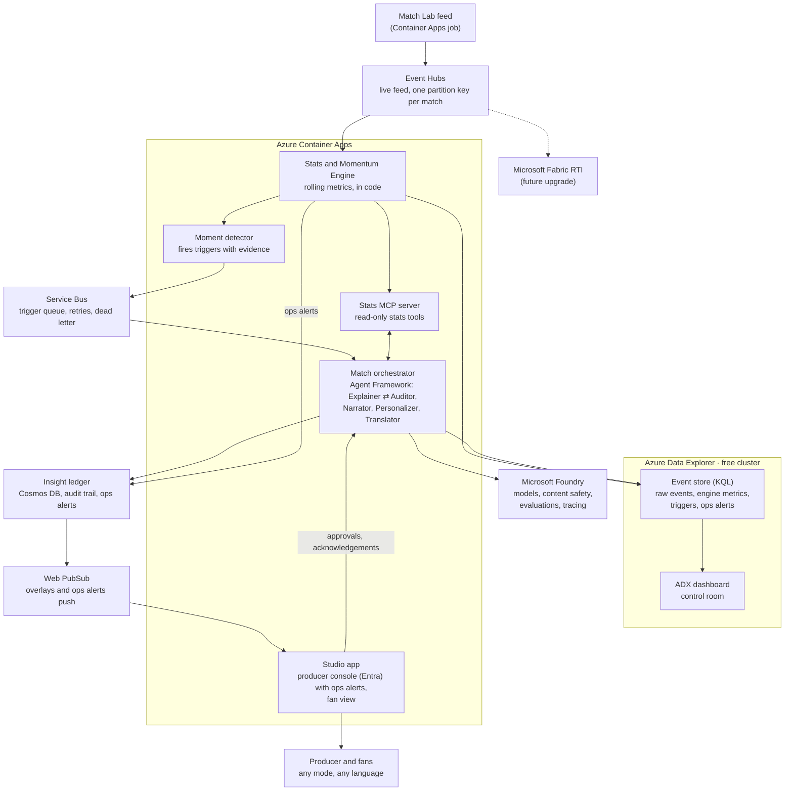

# Architecture

Azure Event Hubs carries the live match feed, Azure Data Explorer (free cluster) stores events and engine metrics for KQL queries and the control-room dashboard, Container Apps runs the Python engine and the agents, and Microsoft Foundry supplies models and guardrails. Every insight is audited before it reaches a screen. The feed and the event store sit behind adapters, so Microsoft Fabric Real-Time Intelligence can take over later as an upgrade (see Future upgrade: Microsoft Fabric).

Across every service: Microsoft Entra ID (managed identities, producer sign-in), Key Vault, Application Insights / Log Analytics, GitHub Actions, Cost Management budget alerts.

## How one moment flows

1. **Generate.** The Match Lab replays a synthetic match and sends events and 1 Hz tracking samples to the live feed (Azure Event Hubs), one batch per second of match time.
2. **Ingest.** The Stats and Momentum Engine reads the feed through the feed adapter. Validation rules reject or flag bad rows; rejects raise an ops alert. The engine appends the raw rows to the event store in Azure Data Explorer.
3. **Compute.** The engine updates team and player state in rolling 5-minute windows: possession, turnovers, PPDA, control and chaos scores, speeds and distances. It writes these snapshots to the event store, so the dashboard shows the same numbers the agents use.
4. **Detect.** The Moment detector sees, for example, the away side's control score fall 20+ points and hold, then puts a trigger with evidence event IDs on the Service Bus queue.
5. **Explain.** The orchestrator picks up the trigger. The Explainer pulls numbers through the Stats MCP server and drafts an insight (headline, explanation, metrics, evidence).
6. **Audit.** The Auditor recomputes every number through the same tools. A mismatch goes back to the Explainer, at most twice; then approve or block. The decision is written to the ledger; a block raises an ops alert.
7. **Approve.** The producer approves in the Studio app (low-risk types such as speed alerts can auto-approve).
8. **Personalize and translate.** Personalizer writes analyst, casual, club, player and single-metric versions concurrently; Translator renders each language concurrently, numbers checked unchanged.
9. **Deliver.** The Overlay builder sets template, timing and priority; overlays are saved to the ledger and pushed through Web PubSub.
10. **Recap.** At half-time and full-time the orchestrator hands off to the Narrator; recaps go through the same audit.

Alongside the flow, the producer console shows **ops alerts** (feed gaps, feed lag, validation rejects, blocked insights, dead-lettered triggers, model fallbacks) as they happen, and the **ADX dashboard** gives producers and analysts the control-room view of the match and the pipeline.

## Components

| Component | Azure service | Role | Challenge stage | Scope |
| --- | --- | --- | --- | --- |
| Match Lab | Container Apps job (Python) | Synthetic matches + planted scenarios; live replay | (a) ingest, (v) data | Core |
| Live feed | Azure Event Hubs (Basic) | Carry events and tracking from the Match Lab to the engine | (a) | Core |
| Event store | Azure Data Explorer free cluster (KQL database) | Raw events and tracking, engine metric snapshots, triggers, insight status, ops alerts; time-window queries; eval checks | (a), (b) | Core |
| Control-room dashboard | ADX dashboard | Producer and analyst control room: match state, momentum, triggers, feed health, insight pipeline | (b), (d) | Core |
| Ops alerts | Studio producer console (ledger + Web PubSub) | Feed gaps and lag, validation rejects, blocked insights, dead letters, model fallbacks; producer acknowledges | Ops | Core |
| Stats and Momentum Engine + Moment detector | Container Apps (Python) | Deterministic metrics and triggers | (b), (c) | Core |
| Service Bus queue | Service Bus (Basic) | Trigger queue `triggers`; max 3 deliveries, then dead letter; adapter `infra_adapters/servicebus.py` | (c) | Core |
| Stats MCP server | Container Apps | Read-only stats tools for agents | (b), (c) | Core |
| Match orchestrator | Container Apps + Microsoft Agent Framework | Five agents + Overlay builder | (c), (d), (e) | Core |
| Microsoft Foundry | Foundry | Models, content safety, evaluations, tracing | (c), (e) | Core |
| Insight ledger | Cosmos DB (free tier) | System of record: insights, evidence, audits, approvals, overlays, ops alerts, viewer profiles. One container `ledger`, partition key `/match_id`; write-through adapter `infra_adapters/cosmos.py` | (c), (d) | Core |
| Web PubSub | Web PubSub (Free tier) | Live overlay and ops-alert push | (d) | Core |
| Studio app | Container Apps (web), Next.js (`studio/`) | Producer console (queue, audit trail, evidence, approve/block; ops alerts to come) + fan view with mode, language, club (player and metric pickers to come); calls `/api/v1` through a Next.js rewrite | (d), (e) | Core |
| Match history (medallion) | Fabric Lakehouse | Bronze/Silver/Gold history | (b) | Stretch (needs Fabric) |
| "Ask the match" | Fabric data agent + Foundry | Natural-language questions for analysts | (e) | Stretch (needs Fabric) |

## Live feed

- **Interface:** `pitch_ledger.feed` defines `FeedPublisher` and `FeedSubscriber`. Adapters: a JSONL file (two local processes), in-memory (tests) and Azure Event Hubs (`infra_adapters/eventhubs.py`). `PITCH_LEDGER_FEED` picks one; domain code never imports the Event Hubs SDK.
- **Messages:** the body is the feed row exactly as in `events.jsonl` / `tracking.jsonl`; properties carry the row kind and the send time (for latency). The partition key is the match ID, so each match's rows arrive in order. A match opens with one `match` message carrying its reference rows (teams, players).
- **Sign-in:** Microsoft Entra ID (managed identity in Azure, the service principal locally), roles *Azure Event Hubs Data Sender* (Match Lab) and *Data Receiver* (engine). A SAS connection string also works.
- **Transport:** plain AMQP inside Azure; AMQP over WebSockets (port 443) behind a proxy (`PITCH_LEDGER_EVENTHUB_TRANSPORT`, default `auto`).
- **Measured (2026-10-09, from a Claude Code cloud session through its proxy, WebSockets):** no messages lost in any of five runs (up to 2,695 messages each); send-to-receive p50 2.5–3.3 s, p95 4.6–7.3 s. A single send takes about 0.27 s; delivery arrives in bursts on this path (best case 0.6 s). This is a pessimistic bound, not the Azure number: re-measure from Container Apps (same region, plain AMQP) in Phase 4.
- **Commands:** `pitch-ledger stream <match_dir>` publishes at match pace (overdue seconds are sent together when publishing falls behind); `pitch-ledger listen` lands the rows and reports send-to-receive latency.
- **Throughput:** Event Hubs Basic with 1 throughput unit accepts about 1,000 messages a second; a match is about 23 a second at real time, so replays stay at or below about 40x (60x was throttled).

## Live service (`pitch-ledger live`)

One process, two concurrent loops (`pitch_ledger.live`):

1. **Ingest:** reads the feed, keeps each match in memory and lands it under `data/live/<match>/` (a match directory the stats tools read), writes raw rows, minute snapshots and feed health to the event store, and every few seconds re-runs the detector over everything received. A trigger is emitted once the feed is 60 match-seconds past it (first-half triggers at the start of the second half; everything at full time) and numbered in match order, so a live run gives exactly the batch triggers (checked on all planted matches). Triggers go to the queue, `triggers.jsonl` and the store.
2. **Worker:** takes triggers off the queue and runs the orchestrator over a snapshot of the match so far; insights, audits and overlays go to the ledger, insight status to the store. `--approve` approves as the demo producer; otherwise insights wait for the producer console.

The feed, queue, ledger and store are the same interfaces as everywhere else (Event Hubs, Service Bus, Cosmos DB, ADX in Azure; files and memory locally).

## Event store and dashboard (Azure Data Explorer)

- **Free cluster:** an Azure Data Explorer free cluster (no Azure cost, no SLA) with one database. `ADX_CLUSTER_URI` and `ADX_DATABASE` locate it. It speaks KQL, the same language and engine as a Fabric Eventhouse.
- **Writers, not a second source of truth:** the engine appends raw rows and its metric snapshots; the orchestrator appends trigger and insight status rows and ops alerts. Cosmos DB stays the system of record for the ledger; ADX is the analytical copy for queries and the dashboard. Writes go through the event-store interface (`pitch_ledger.eventstore`; ADX adapter in `infra_adapters/adx.py`), batched every few seconds or 5,000 rows and sent by managed streaming ingestion; domain code never imports the Kusto SDK. `pitch-ledger store <match_dir>` writes a whole match; `listen --store` writes rows and feed health as they arrive.
- **Tables:** `Events` and `Tracking` (feed rows, schema doc columns), `TeamState` (engine snapshots per team every minute over the rolling 5-minute window), `Triggers`, `InsightStatus`, `OpsAlerts`, `FeedHealth` (latency per minute), `StoreCheck` (setup test). Defined once in `src/pitch_ledger/eventstore/tables.py`; `infra/adx/tables.kql` (from `pitch-ledger store-schema`) creates them with JSON mappings, streaming ingestion and a 10-second batching fallback. Tile queries: `infra/adx/dashboard.kql`.
- **Same numbers everywhere:** dashboard tiles show engine-computed values from `TeamState` and `Triggers`; KQL only filters, counts and charts them (and computes feed-health timings). The dashboard never derives its own football metrics, so the studio, the ledger and the dashboard agree.
- **ADX dashboard (control room):** match clock and score, control score per team over time with momentum triggers marked, possession and pressing by window, feed latency and gaps, insight pipeline (drafted, blocked, approved, aired), latest ops alerts. Built in the Azure Data Explorer web UI against the free cluster; the tile queries are kept in the repo.
- **Local-first:** without ADX settings, the event-store adapter writes the same tables as local files, so everything still runs offline.

## Ops alerts (producer console)

| Alert | Raised by | Initial rule |
| --- | --- | --- |
| Feed gap | Engine | No feed message for 10 s during play |
| Feed lag | Engine | p95 send-to-receive latency above 5 s over a minute |
| Validation reject | Engine (validation rules) | Any rejected row; flags summarized per minute |
| Insight blocked | Orchestrator (Auditor) | Auditor blocks a draft after the last round |
| Trigger dead-lettered | Trigger queue | A trigger exceeds its delivery attempts |
| Model fallback | Model manager | A template fallback was used or the call budget is spent |

Each alert is a record in the ledger (match, kind, severity, message, evidence references, raised time, acknowledged by), pushed through Web PubSub to an ops panel in the producer console, where the producer acknowledges it. Alerts are also appended to the `OpsAlerts` table for the dashboard and logged to Application Insights. Out-of-hours notification (Azure Monitor alert rules on the logs) is production path.

## API (`/api/v1`)

FastAPI (`pitch_ledger.api`, `pitch-ledger api`); OpenAPI docs at `/api/v1/docs`. Reads the same ledger as the orchestrator (local files or Cosmos DB) and the match files.

| Endpoint | Who | Returns |
| --- | --- | --- |
| `GET /api/v1/health` | anyone | status, ledger, match count |
| `GET /api/v1/matches`, `GET /api/v1/matches/{id}` | anyone | teams, kickoff, venue; players' display names, score, last minute |
| `GET /api/v1/matches/{id}/overlays?mode=&language=` | anyone (fan view) | overlays of **aired** insights only, in match order |
| `GET /api/v1/me` | producer | the signed-in producer |
| `GET /api/v1/matches/{id}/insights?status=` | producer | every insight with status (aired, pending, blocked) |
| `GET /api/v1/insights/{id}` | producer | insight, audit trail, cited evidence events, overlays |
| `POST /api/v1/insights/{id}/decision` | producer | approve or block; approval runs the Personalizer and Translator |

- **Producer sign-in:** a Microsoft Entra ID access token for the API app registration with the `Producer` app role. The producer's identity (recorded as `approved_by`) comes from the verified token, never from the request. If the API's Entra settings are missing, producer endpoints refuse (fail closed); `PITCH_LEDGER_API_AUTH=dev` is a local-only stand-in.
- **Controls:** request bodies reject unknown fields; IDs are pattern-checked before they reach a file path; CORS is limited to the Studio's origin; decisions are rate-limited per producer (they cost model calls); responses are dedicated schemas (fans never see ratings, audits or pending insights).

## Agents and orchestration

| Agent | Job | Model tier | Pattern |
| --- | --- | --- | --- |
| Explainer | Why a moment matters, citing evidence events | Stronger | Sequential; maker in maker-checker loop |
| Auditor | Recomputes every number; checks claims, tone, neutrality; approve, correct or block | Stronger | Checker (max 2 rounds) |
| Narrator | Player context, milestones, half-time and full-time recaps | Stronger | Handoff at breaks; output audited |
| Personalizer | Analyst, casual, club, player and single-metric versions | Small, fast | Concurrent fan-out per mode |
| Translator | Every version into each language, numbers unchanged | Small, fast | Concurrent fan-out per language |

Failure handling: a model error retries once, then falls back to a plain template overlay built from code-computed numbers; a blocked insight never airs and is logged; Service Bus dead-letters a trigger that keeps failing. Each of these raises an ops alert.

## Enterprise controls (built)

- **No numbers from the model.** Every figure comes from code via read-only MCP tools; the Auditor recomputes before air.
- **Evidence on every insight**, stored in the Cosmos DB ledger with continuous backup.
- **Human in the loop:** Entra ID sign-in; only the producer role approves or blocks, and acknowledges ops alerts.
- **Managed identities, no keys**; Key Vault only for secrets that cannot use Entra ID.
- **Content safety** policies on every model deployment, as code.
- **Agents, prompts and infrastructure as code**, deployed by GitHub Actions; model versions pinned.
- **Data validation** at ingest; rejects raise ops alerts.
- **Evaluations:** planted scenarios as a test suite (detection rate, false alerts, factual accuracy), tracked in Foundry.
- **Observability:** Application Insights, Log Analytics, Foundry tracing from event to overlay; ADX dashboard for match and pipeline health; ops alerts in the producer console.
- **Cost controls:** token caps per agent, small model for rewrites, budget alerts, scale-to-zero, Azure Data Explorer free cluster, Event Hubs on the Basic tier.

## Future upgrade: Microsoft Fabric

Fabric Real-Time Intelligence was the original plan; its trial is not available to this account (2026-10-09). Every piece used today has a direct Fabric counterpart, and the adapters keep the move small:

| Today | Fabric counterpart | How to move |
| --- | --- | --- |
| Event Hubs (live feed) | Eventstream | Add the Event Hub as an Eventstream source (no code or setting change; Eventstream needs its own consumer group, so Event Hubs Standard), or replace the hub with an Eventstream custom endpoint by setting `PITCH_LEDGER_EVENTHUB_CONNECTION` (same adapter, Event Hubs protocol) |
| ADX free cluster (event store) | Eventhouse (KQL database) | Same KQL engine: create the same tables and mappings, point the event-store adapter at the Eventhouse query URI; queries move unchanged |
| ADX dashboard | Real-Time Dashboard | Same KQL tile queries; recreate the tiles against the Eventhouse |
| Producer-console ops alerts | Activator | Add Activator rules on the `OpsAlerts` table for email or Teams notifications; the producer console stays the primary view |
| (none) | Lakehouse, Fabric data agent | Stretch goals once Fabric is available |

## Production path (documented, not built)

Private endpoints and a virtual network; Application Gateway with WAF and DDoS Protection; Azure Firewall for agent egress; zone-redundant and data-zone model deployments; API Management in front of models; Defender for AI services; a full Azure Data Explorer cluster or Fabric Eventhouse with an SLA instead of the free cluster; Azure Monitor alert rules for out-of-hours ops alerts; Purview over the data estate; separate dev, test and production Foundry resources.

## Cost plan (no hackathon credits provided)

| Item | Approach |
| --- | --- |
| Azure subscription | Personal Azure free account ($200 credit, 30 days) in the personal Default Directory; upgrade to pay-as-you-go before credit expires so the demo stays live until judging ends (Nov 20) |
| Event Hubs | Basic tier, 1 throughput unit: about $11/month plus about $0.03 per million events (check the pricing page). Created 2026-10-09 (`pitch-ledger-feed`); recurring, delete it after judging (Nov 20) |
| Azure Data Explorer | Free cluster: no Azure cost, no SLA |
| Fabric | Future upgrade (trial not available) |
| Container Apps | Consumption plan free grant; scale to zero |
| Cosmos DB | Lifetime free tier (1000 RU/s, 25 GB), account throughput capped at the free amount |
| Service Bus | Basic tier: no base fee, about $0.05 per million operations (check the pricing page); a match is a few hundred operations |
| Web PubSub | Free tier (20 connections, 20k messages/day) |
| Container images | GitHub Container Registry (free for public images) instead of Azure Container Registry |
| Models | Main cost; token caps, small model for rewrites, develop locally first |
| Guardrail | Budget alerts at $25 and $50 |

**Never** use the former employer's tenant, subscription or credits.

## Open items

- [x] Live feed (2026-10-09): Fabric trial not available, so the live feed uses Azure Event Hubs behind the feed adapter. First live measurement done from a cloud session (see Live feed); re-measure from Container Apps.
- [x] Fabric-dependent pieces (2026-10-09): Eventhouse → Azure Data Explorer free cluster, RTI dashboard → ADX dashboard, Activator → ops alerts in the producer console. Fabric kept as a future upgrade.
- [ ] ADX: confirm the free cluster accepts the service principal as a database ingestor and viewer, and the ingestion delay (set the tables' batching policy to a few seconds, or use streaming ingestion if the free cluster offers it).
- [x] Event-store tables documented in `docs/event-schema.md` (2026-10-09).
- [ ] Add the full ops-alert record to `docs/event-schema.md` when the alerts are raised in code.
- [ ] Hosted agents: if time allows, test the orchestrator as a Foundry hosted agent.
- [ ] Confirm agent-capable models available in the chosen region (one stronger, one small).
- [x] Fabric sign-up: the trial is not available for this account (2026-10-09).
