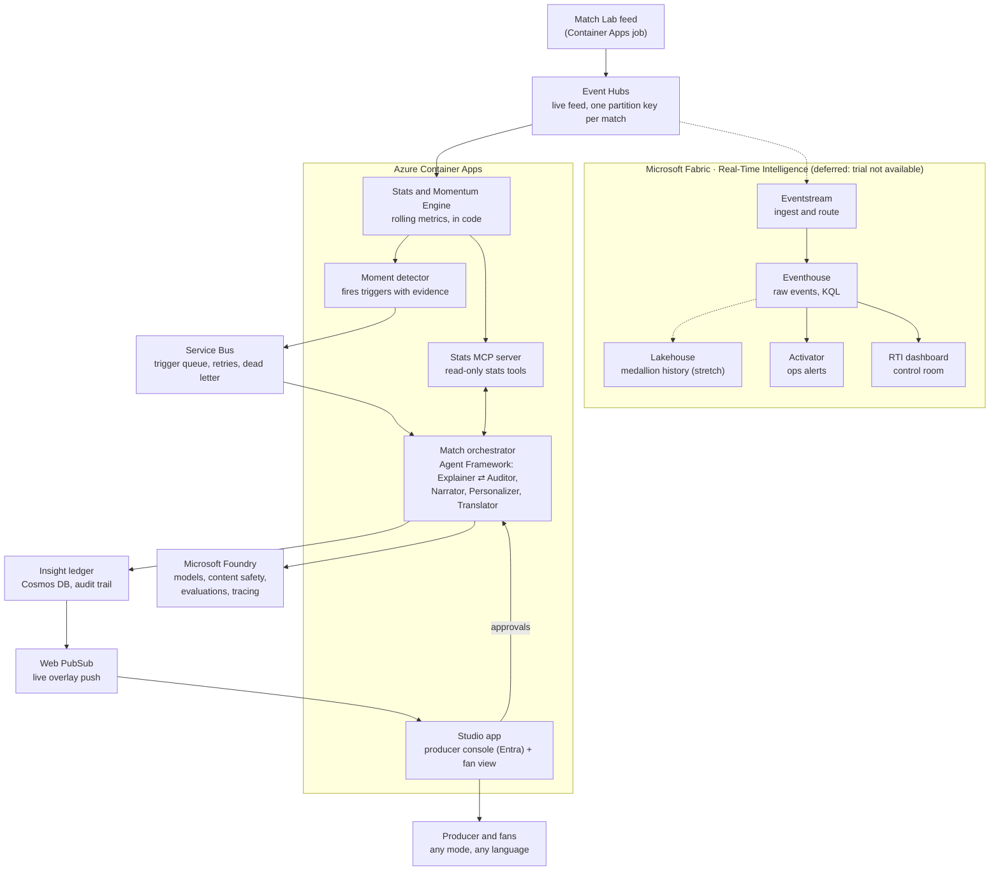

# Architecture

Azure Event Hubs carries the live match feed, Container Apps runs the Python engine and the agents, and Microsoft Foundry supplies models and guardrails. The feed sits behind an adapter, so Fabric Eventstream can take over later without code changes (see Live feed). Every insight is audited before it reaches a screen.

Across every service: Microsoft Entra ID (managed identities, producer sign-in), Key Vault, Application Insights / Log Analytics, GitHub Actions, Cost Management budget alerts.

## How one moment flows

1. **Generate.** The Match Lab replays a synthetic match and sends events and 1 Hz tracking samples to the live feed (Azure Event Hubs), one batch per second of match time.
2. **Ingest.** The Stats and Momentum Engine reads the feed through the feed adapter (live processing). Validation rules reject or flag bad rows. Event storage and KQL queries in the Fabric Eventhouse are deferred while Fabric is unavailable.
3. **Compute.** The engine updates team and player state in rolling 5-minute windows: possession, turnovers, PPDA, control and chaos scores, speeds and distances.
4. **Detect.** The Moment detector sees, for example, the away side's control score fall 20+ points and hold, then puts a trigger with evidence event IDs on the Service Bus queue.
5. **Explain.** The orchestrator picks up the trigger. The Explainer pulls numbers through the Stats MCP server and drafts an insight (headline, explanation, metrics, evidence).
6. **Audit.** The Auditor recomputes every number through the same tools. A mismatch goes back to the Explainer, at most twice; then approve or block. The decision is written to the ledger.
7. **Approve.** The producer approves in the Studio app (low-risk types such as speed alerts can auto-approve).
8. **Personalize and translate.** Personalizer writes analyst, casual, club, player and single-metric versions concurrently; Translator renders each language concurrently, numbers checked unchanged.
9. **Deliver.** The Overlay builder sets template, timing and priority; overlays are saved to the ledger and pushed through Web PubSub.
10. **Recap.** At half-time and full-time the orchestrator hands off to the Narrator; recaps go through the same audit.

## Components

| Component | Azure service | Role | Challenge stage | Scope |
| --- | --- | --- | --- | --- |
| Match Lab | Container Apps job (Python) | Synthetic matches + planted scenarios; live replay | (a) ingest, (v) data | Core |
| Live feed | Azure Event Hubs (Basic) | Carry events and tracking from the Match Lab to the engine | (a) | Core |
| Eventstream | Fabric RTI | Ingest and route events and tracking; reads the Event Hub or replaces it via its custom endpoint | (a) | Deferred (Fabric trial not available) |
| Eventhouse | Fabric RTI (KQL DB) | Raw events; time-window queries; eval checks | (a), (b) | Deferred (needs Fabric) |
| RTI dashboard | Fabric | Producer and analyst control room | (b), (d) | Deferred (needs Fabric) |
| Activator | Fabric | Ops alerts: feed gaps, validation rejects, blocked insights | Ops | Deferred (needs Fabric) |
| Lakehouse (Bronze/Silver/Gold) | Fabric OneLake | Match history | (b) | Stretch |
| Stats and Momentum Engine + Moment detector | Container Apps (Python) | Deterministic metrics and triggers | (b), (c) | Core |
| Service Bus queue | Service Bus | Trigger queue; retries, dead letter | (c) | Core |
| Stats MCP server | Container Apps | Read-only stats tools for agents | (b), (c) | Core |
| Match orchestrator | Container Apps + Microsoft Agent Framework | Five agents + Overlay builder | (c), (d), (e) | Core |
| Microsoft Foundry | Foundry | Models, content safety, evaluations, tracing | (c), (e) | Core |
| Insight ledger | Cosmos DB (free tier) | Insights, evidence, audits, approvals, overlays, viewer profiles | (c), (d) | Core |
| Web PubSub | Web PubSub (Free tier) | Live overlay push | (d) | Core |
| Studio app | Container Apps (web) | Producer console + fan view with mode, club, player, metric, language | (d), (e) | Core |
| Fabric data agent | Fabric + Foundry | "Ask the match" for analysts | (e) | Stretch |

## Live feed

- **Interface:** `pitch_ledger.feed` defines `FeedPublisher` and `FeedSubscriber`. Adapters: a JSONL file (two local processes), in-memory (tests) and Azure Event Hubs (`infra_adapters/eventhubs.py`). `PITCH_LEDGER_FEED` picks one; domain code never imports the Event Hubs SDK.
- **Messages:** the body is the feed row exactly as in `events.jsonl` / `tracking.jsonl`; properties carry the row kind and the send time (for latency). The partition key is the match ID, so each match's rows arrive in order.
- **Sign-in:** Microsoft Entra ID (managed identity in Azure, the service principal locally), roles *Azure Event Hubs Data Sender* (Match Lab) and *Data Receiver* (engine). A SAS connection string also works.
- **Switching to Fabric later, without code changes:**
  1. Keep Event Hubs and add the hub as an **Eventstream source**, routing on to the Eventhouse and the RTI dashboard. Nothing changes in our code or settings. (Give Eventstream its own consumer group, which needs the Standard tier.)
  2. Or replace the hub: create an Eventstream **custom endpoint** and set `PITCH_LEDGER_EVENTHUB_CONNECTION` to its connection string. Custom endpoints speak the Event Hubs protocol, so the same adapter is used.
- **Commands:** `pitch-ledger stream <match_dir>` publishes at match pace; `pitch-ledger listen` lands the rows and reports send-to-receive latency.

## Agents and orchestration

| Agent | Job | Model tier | Pattern |
| --- | --- | --- | --- |
| Explainer | Why a moment matters, citing evidence events | Stronger | Sequential; maker in maker-checker loop |
| Auditor | Recomputes every number; checks claims, tone, neutrality; approve, correct or block | Stronger | Checker (max 2 rounds) |
| Narrator | Player context, milestones, half-time and full-time recaps | Stronger | Handoff at breaks; output audited |
| Personalizer | Analyst, casual, club, player and single-metric versions | Small, fast | Concurrent fan-out per mode |
| Translator | Every version into each language, numbers unchanged | Small, fast | Concurrent fan-out per language |

Failure handling: a model error retries once, then falls back to a plain template overlay built from code-computed numbers; a blocked insight never airs and is logged; Service Bus dead-letters a trigger that keeps failing.

## Enterprise controls (built)

- **No numbers from the model.** Every figure comes from code via read-only MCP tools; the Auditor recomputes before air.
- **Evidence on every insight**, stored in the Cosmos DB ledger with continuous backup.
- **Human in the loop:** Entra ID sign-in; only the producer role approves or blocks.
- **Managed identities, no keys**; Key Vault only for secrets that cannot use Entra ID.
- **Content safety** policies on every model deployment, as code.
- **Agents, prompts and infrastructure as code**, deployed by GitHub Actions; model versions pinned.
- **Data validation** at ingest.
- **Evaluations:** planted scenarios as a test suite (detection rate, false alerts, factual accuracy), tracked in Foundry.
- **Observability:** Application Insights, Log Analytics, Foundry tracing from event to overlay.
- **Cost controls:** token caps per agent, small model for rewrites, budget alerts, scale-to-zero, Event Hubs on the Basic tier and created only for the live-demo window.

## Production path (documented, not built)

Private endpoints and a virtual network; Application Gateway with WAF and DDoS Protection; Azure Firewall for agent egress; zone-redundant and data-zone model deployments; API Management in front of models; Defender for AI services; Purview over Fabric data; separate dev, test and production Foundry resources.

## Cost plan (no hackathon credits provided)

| Item | Approach |
| --- | --- |
| Azure subscription | Personal Azure free account ($200 credit, 30 days) in the personal Default Directory; upgrade to pay-as-you-go before credit expires so the demo stays live until judging ends (Nov 20) |
| Fabric | Not available (trial not offered to this account); Fabric components deferred |
| Event Hubs | Basic tier, 1 throughput unit: about $11/month plus about $0.03 per million events (check the pricing page). Recurring and not free: create it when Phase 4 deployment starts, delete it after judging (Nov 20) |
| Container Apps | Consumption plan free grant; scale to zero |
| Cosmos DB | Lifetime free tier (1000 RU/s, 25 GB) |
| Web PubSub | Free tier (20 connections, 20k messages/day) |
| Container images | GitHub Container Registry (free for public images) instead of Azure Container Registry |
| Models | Main cost; token caps, small model for rewrites, develop locally first |
| Guardrail | Budget alerts at $25 and $50 |

**Never** use the former employer's tenant, subscription or credits.

## Open items

- [x] Live feed (2026-10-09): Fabric trial not available, so the live feed uses Azure Event Hubs behind the feed adapter. Measure the hop with `stream` + `listen` once the namespace exists.
- [ ] Fabric-dependent pieces (Eventhouse storage and KQL, RTI dashboard, Activator alerts): decide whether to replace them with other Azure services or leave them out.
- [ ] Hosted agents: if time allows, test the orchestrator as a Foundry hosted agent.
- [ ] Confirm agent-capable models available in the chosen region (one stronger, one small).
- [x] Fabric sign-up: the trial is not available for this account (2026-10-09).
